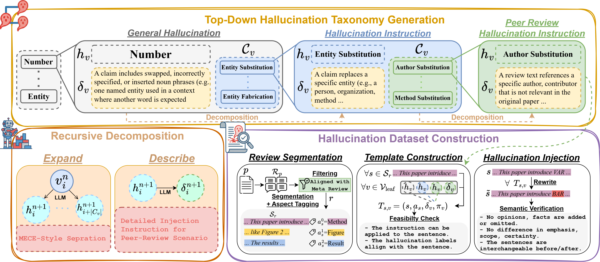

# HalluPeer: A Taxonomy-driven Benchmark for Detecting Hallucinations in Scientific Peer Reviews



*📝 Accepted at EMNLP 2026 Findings*

[[Paper]](https://arxiv.org/abs/2609.03580) [[Dataset]](https://huggingface.co/datasets/Lin-TzuLing/HalluPeer)

This repository contains the dataset construction pipeline and the evaluation code for **HalluPeer**, a benchmark for detecting hallucinations in LLM-assisted scientific peer reviews.
HalluPeer injects controlled hallucinations into human-written ICLR (2019–2024) and NeurIPS (2021–2024) reviews following a peer-review–specific hallucination taxonomy, and defines three tasks:

| Task | Level | Goal |
|---|---|---|
| Task 1 — Detection | review / sentence | Does the text contain a hallucination? (binary) |
| Task 2 — Type classification | review / sentence | Which of 9 hallucination types is it? |
| Task 3 — Localization | review | Which span of the review is hallucinated? |

The construction pipeline has three stages (see the figure):
1. **Top-down hallucination taxonomy generation** — recursive LLM decomposition (expand / describe) from general hallucination categories to peer-review–specific injection instructions.
2. **Review segmentation** — paper parsing, review filtering against the meta-review, sentence segmentation and aspect tagging.
3. **Template construction and hallucination injection** — feasibility-checked (sentence, taxonomy leaf) templates, LLM rewriting, and semantic verification of every injected sentence.

## Repository Structure

```
HalluPeer/
├── hallupeer/              # dataset construction package
│   ├── parse_papers/       #   PDF parsing with GROBID
│   ├── dataset/            #   OpenReview loaders, review filtering, segmentation
│   ├── hallucination_taxonomy/   # taxonomy generation, ensembling, filtering
│   ├── dataset_construction/     # aspect tagging, template construction, injection
│   └── agents/             #   LLM agent wrappers (OpenAI-compatible / vLLM)
├── dataset/                # benchmark data, downloaded from Hugging Face (see dataset/README.md)
├── data_gen/               # injected data → Task 1/2/3 train/dev/test splits
├── evaluation/             # zero-shot LLMs, baselines, QLoRA fine-tuning
├── configs/                # YAML configs for the construction pipeline
├── prompts/                # construction prompts
├── resources/              # taxonomy seed nodes, review-aspect inventory, review-filter cache
├── scripts/                # vLLM + pipeline launchers for construction / injection
└── assets/
```

Each folder has its own README with details.

## Installation

```bash
git clone https://github.com/Lin-TzuLing/HalluPeer.git
cd HalluPeer
pip install -r requirements.txt
```

vLLM serving and Unsloth fine-tuning need different `torch` / `transformers` versions; install them in separate environments as described at the top of `requirements.txt`.
All LLM components are queried through an OpenAI-compatible endpoint (a local vLLM server by default).

## Dataset

The benchmark is hosted on Hugging Face: [`Lin-TzuLing/HalluPeer`](https://huggingface.co/datasets/Lin-TzuLing/HalluPeer).

Download it into `dataset/` (see `dataset/README.md` for the layout):

```bash
hf download Lin-TzuLing/HalluPeer --repo-type dataset --local-dir dataset
```

| Folder | Content |
|---|---|
| `dataset/task_split/` | Task 1/2/3 splits, 10 venues, injector Qwen3-32B |
| `dataset/task_split_{Llama,Mistral}/` | ICLR / NeurIPS 2024 splits, injector Llama-3.3-70B / Mistral-Small-3.1-24B |
| `dataset/template_injection/` | One `{paper_id}.json` per paper: paper text (evidence), reviews, injection templates |
| `dataset/template_injection_{Llama,Mistral}/` | Same for the Llama / Mistral injected data |
| `dataset/taxonomy/filtered_human.pkl` | Final hallucination taxonomy tree, read by template construction (not needed for evaluation) |

Every evaluator reads the task rows with `--input` and the paper text with `--source_data` (`{paper_id}.json` → `paper_content`).
Each split is a JSONL file `HalluPeer_{venue}/{task}/{train,dev,test}.jsonl`; field descriptions are in the dataset card.

### Raw OpenReview data (only for rebuilding the dataset)

Evaluating on HalluPeer does not require the raw data. Rebuilding the dataset from scratch starts from OpenReview submissions, organised per venue as below.
By default the pipeline reads `../datasets/openreview_data/{venue}` (a `datasets/` folder next to this repository); change `dataset_dir` in `configs/dataset.yaml`, the PDF paths in `configs/parse.yaml`, or `DATASETS` in `scripts/*/*.sh` to use another location.

```
openreview_data/
└── {ICLR2019 … ICLR2024, NeurIPS2021 … NeurIPS2024}/
    ├── notes/{idx}.json              # OpenReview note dump: submission metadata, reviews, meta-review / decision
    ├── paper/{idx}.pdf               # submission PDF
    └── parsed_pdfs/{idx}.json        # GROBID output, produced by `python -m hallupeer.parse_papers.parsing`
```

The raw PDFs and OpenReview dumps are not redistributed in this repository; they can be collected from [OpenReview](https://openreview.net) for the venues above.
`{idx}` is a per-venue numeric file index shared by the three folders (the OpenReview forum id is the `forum` field of each note). HalluPeer samples 1,200 papers per venue; a released `paper_id` is `{venue}_{idx}`, e.g. `NeurIPS2024_1069`.

## Usage

### Dataset construction

Run from the repository root; every step reads `configs/*.yaml` and talks to a vLLM server (`configs/agents.yaml` sets model and port).

```bash
# 1. Parse paper PDFs (GROBID server required)
python -m hallupeer.parse_papers.parsing --grobid_port 8070

# 2. Tag review sentences with aspects (reviews are filtered and segmented on load)
python -m hallupeer.dataset_construction.review_aspect_tagging.tag_review_aspect \
    --dataset_dir <openreview_data>/NeurIPS2024 --port 8001

# 3. Generate the hallucination taxonomy (see hallupeer/hallucination_taxonomy/README.md for ensembling / filtering)
python -m hallupeer.hallucination_taxonomy.generate_taxonomy --model_name Qwen/Qwen3-32B --port 8003

# 4. Construct templates and inject hallucinations (launchers start vLLM automatically)
bash scripts/construct/construct_templates.sh
bash scripts/inject/inject_templates.sh

# 5. Build Task 1/2/3 splits
python data_gen/generate_data.py --input dataset/template_injection/HalluPeer_NeurIPS2024 \
    --out dataset/task_split/HalluPeer_NeurIPS2024 --datasets all --seed 42
```

### Evaluation

```bash
# Zero-shot LLMs (vLLM): sweeps models × evidence (no_retrieval / BM25)
bash evaluation/task_1/bash_script/task1_zeroshot.sh
bash evaluation/task_2/bash_script/task2_zeroshot.sh
bash evaluation/task_3/bash_script/task3_zeroshot.sh

# Specialized verification baselines (HHEM, TrueNLI, TrueTeacher, SentLI, RefChecker, RA-LLM)
bash evaluation/task_1/baseline/bash_script/hhem.sh

# QLoRA fine-tuning (Qwen2.5-3B/7B, Qwen3-32B, GPT-OSS-20B)
bash evaluation/task_1/finetune/bash_script/task1_finetune_qlora_logit_7B.sh
```

See `evaluation/README.md` for all options.

## License

The code is released under the [Apache License 2.0](LICENSE); the dataset is released under [CC BY 4.0](https://creativecommons.org/licenses/by/4.0/).

## Citation

```bibtex
@article{lin2026hallupeer,
  title={HalluPeer: A Taxonomy-driven Benchmark for Detecting Hallucinations in Scientific Peer Reviews},
  author={Lin, Tzu-Ling and Yao, Dong-Ting and Hsiao, Teng-Fang and Chen, Wei-Chih and Shuai, Hong-Han},
  journal={arXiv preprint arXiv:2609.03580},
  year={2026}
}
```

## Contact
> tzulinglin.11@nycu.edu.tw

The cross-venue / cross-generator generalization experiments and the human-review analysis reported in the paper are not part of this release yet; please contact us if you need them.
